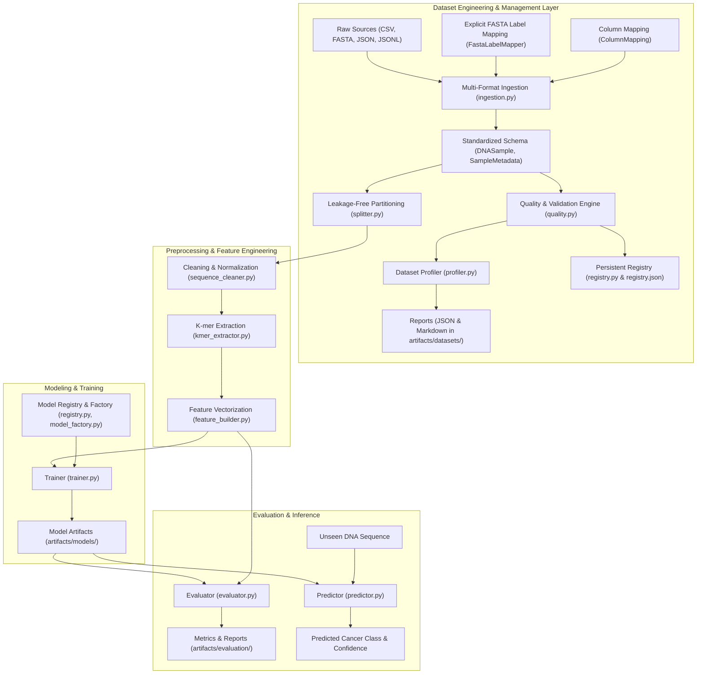

# System Architecture: DNA Cancer Classification Framework

## 1. Architectural Overview

The **DNA Cancer Classification** system is built upon modular, clean architecture principles for machine learning and bioinformatics pipelines: strict separation of concerns, defensive validation, explicit data provenance, reproducible configurations, and zero leakage between data partitions.

The system handles biological DNA sequences end-to-end: from multi-format ingestion, quality auditing, and persistent dataset registration through $k$-mer tokenization, sparse feature vectorization, and model training/inference.

---

## 2. Layer Decomposition

### 2.1 Configuration Layer (`configs/`, `src/dna_cancer/config/`)
- **Declarative YAML Configurations:** Path mappings, sequence constraints, $k$-mer parameters ($k=6$, stride $=1$), vectorization methods, and training hyperparameters are isolated in YAML configuration files.
- **Resilient Fallback Parser:** Provides zero-dependency configuration loading while supporting PyYAML when installed. Paths resolve relative to project root across Windows and POSIX platforms.

### 2.2 Dataset Engineering & Management Layer (`src/dna_cancer/data/`)
- **Unified Schema (`schema.py`):**
  - Defines `DNASample` and `SampleMetadata`.
  - Enforces sample identity, sequence data, and cancer labels while maintaining biological provenance (organism, gene, chromosome, platform, patient ID) strictly separate from prediction targets.
  - Implements `compute_reverse_complement()` for strandedness analysis.
- **Multi-Format Ingestion (`ingestion.py`):**
  - Universal loader (`load_samples`) ingesting CSV, FASTA, JSON, and JSONL formats into standardized `DNASample` objects.
  - Configurable `ColumnMapping` for datasets with heterogeneous column naming conventions.
  - `FastaLabelMapper` for associating external phenotypic/disease annotations with FASTA sequence IDs without heuristics.
- **Quality Assurance & Anomaly Detection (`quality.py`):**
  - Detects duplicate sequences, duplicate sample IDs, conflicting annotations (identical sequence assigned differing cancer types), reverse-complement duplicates, invalid nucleotide characters, and class imbalance.
  - Configurable duplicate handling policies via `DuplicatePolicy` (`REPORT_ONLY`, `KEEP_FIRST`, `REMOVE_ALL`, `ERROR`).
- **Dataset Profiler (`profiler.py`):**
  - Computes comprehensive sequence length statistics (min, max, mean, median, standard deviation, quartiles), nucleotide composition (A, C, G, T, N frequencies), overall GC-content, and metadata completeness.
  - Exports dual-format reports: structured machine-readable JSON and human-readable GitHub Flavored Markdown in `artifacts/datasets/`.
- **Persistent Dataset Registry (`registry.py`):**
  - Transparent, lightweight JSON registry (`artifacts/datasets/registry.json`).
  - Assigns unique dataset identifiers, tracks schema versions, records SHA-256 checksums to detect modifications, and supports semantic dataset versioning.
- **Leakage-Free Splitting (`splitter.py`):**
  - Implements grouped splitting (`split_grouped`), stratified splitting (`split_stratified`), and random splitting (`split_random`).
  - Group-based splitting strictly isolates patient records (`patient_id`), guaranteeing zero patient overlap between train, validation, and test subsets.
  - Automated strategy recommendation (`recommend_splitting_strategy`) based on dataset metadata inspection.

### 2.3 Preprocessing Layer (`src/dna_cancer/preprocessing/`)
- **Sequence Cleaning (`sequence_cleaner.py`):** Strips whitespace, line breaks, carriage returns, and unsupported characters; standardizes casing and replaces or removes ambiguous nucleotides.
- **Processing Pipeline (`sequence_processor.py`):** Orchestrates sequence cleaning and filtering across single sequences, lists, or full DataFrames, recording dropped sample statistics.

### 2.4 Feature Engineering Layer (`src/dna_cancer/features/`)
- **$k$-mer Extractor (`kmer_extractor.py`):** Decomposes continuous nucleotide sequences into overlapping or strided $k$-mers (sub-sequences of length $k$). Supports space-delimited sentence formatting for NLP-style bag-of-words tokenization.
- **Feature Builder (`feature_builder.py`):** Encapsulates feature vectorization (`CountVectorizer`, `TfidfVectorizer`) and target label encoding (`LabelEncoder`). Manages serialization and deserialization of vectorizer artifacts.

### 2.5 Model Architecture & Factory Layer (`src/dna_cancer/models/`)
- **Base Classifier Interface (`base_model.py`):** Abstract base class (`BaseDNAClassifier`) enforcing common `fit`, `predict`, `predict_proba`, `save`, and `load` contracts.
- **Registry Pattern (`registry.py`):** Dynamic registration decorator (`@register_model`) allowing decoupling of model implementations from caller pipelines.
- **Factory Pattern (`model_factory.py`):** Centralized factory for instantiating and loading registered model architectures.

### 2.6 Training Orchestration Layer (`src/dna_cancer/training/`)
- **Trainer (`trainer.py`):** Encapsulates training loops, epoch iterations, validation monitoring, and checkpoint persistence.
- **Pipeline (`pipeline.py`):** Coordinates the end-to-end training lifecycle from raw dataset ingestion through feature building and artifact export.

### 2.7 Evaluation & Inference Layer (`src/dna_cancer/evaluation/`, `src/dna_cancer/prediction/`)
- **Metrics (`metrics.py`):** Computes accuracy, macro/weighted precision, recall, F1 scores, confusion matrices, and detailed per-class classification reports.
- **Evaluator (`evaluator.py`):** Executes evaluation runs and exports structured JSON performance reports to `artifacts/evaluation/`.
- **Inference Predictor (`predictor.py`):** High-level inference engine that accepts raw DNA sequence strings, validates and cleans them, extracts features, and outputs classified cancer types with prediction probabilities.

---

## 3. Data Flow

1. **Ingest & Map:** Raw FASTA, CSV, JSON, or JSONL files are ingested via `load_samples()`. External FASTA identifiers are mapped to cancer classes via `FastaLabelMapper`.
2. **Quality Audit & Profiling:** The dataset is audited by `DatasetValidator` (detecting duplicates, conflicts, reverse complements) and profiled by `DatasetProfiler` (calculating GC-content, length distributions).
3. **Registry Checkpoint:** Dataset metadata, format, sample count, and SHA-256 checksum are cataloged in `artifacts/datasets/registry.json`.
4. **Leakage-Free Partition:** Samples are partitioned into train (70%), validation (15%), and test (15%) subsets using `split_grouped` (grouped by `patient_id` to prevent data leakage) or `split_stratified`.
5. **Tokenize & Vectorize:** Cleaned sequences are tokenized into $k$-mers ($k=6$) and vectorized via count or TF-IDF vectorizers.
6. **Train & Persist:** Models instantiated via `ModelFactory` are trained, evaluated on held-out test splits, and saved into `artifacts/models/`.
7. **Predict:** Production sequences are passed to `DNAPredictor` for real-time inference with probability distributions.
