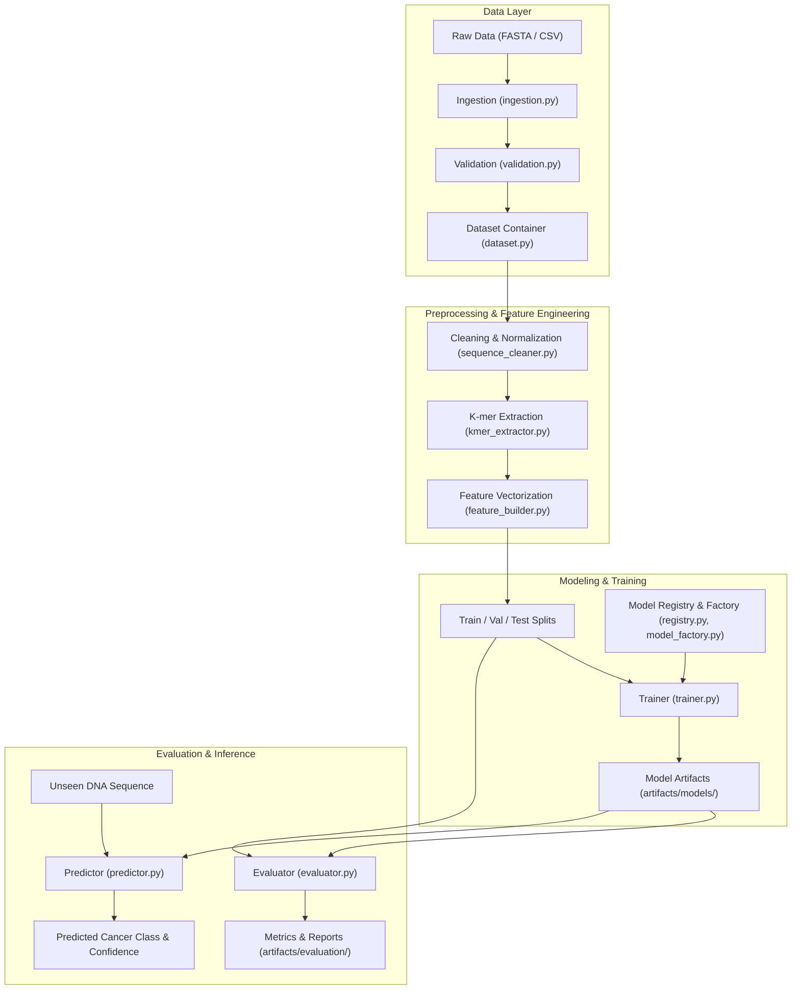

# System Architecture: DNA Cancer Classification Framework

## 1. Architectural Overview

The **DNA Cancer Classification** system is designed around clean architecture principles for machine learning systems: separation of concerns, modularity, reproducible configurations, decoupled components, and defensive validation.

The system transforms biological DNA sequences into mathematical feature spaces using overlapping $k$-mers and vectorization methods, and maps them to oncological classification labels via pluggable statistical and machine learning classifiers.

---

## 2. Layer Decomposition

### 2.1 Configuration Layer (`configs/`, `src/dna_cancer/config/`)
- **Centralized Declarative Settings:** Avoids magic constants and hardcoded paths. All parameters for data paths, $k$-mer extraction ($k=6$, stride $=1$), vectorization (Count/TF-IDF), and model architectures reside in YAML configurations (`configs/`).
- **Resilient Fallback Parser:** Provides zero-dependency configuration loading while supporting PyYAML when installed.

### 2.2 Data Ingestion & Validation Layer (`src/dna_cancer/data/`)
- **Ingestion (`ingestion.py`):** Loads raw genomic sequences from FASTA files and tabular CSV formats.
- **Validation (`validation.py`):** Validates nucleotide characters against standard IUPAC alphabets (`ACGTN`), verifies sequence length bounds, and validates dataset column schemas.
- **Dataset Abstraction (`dataset.py`):** Encapsulates sequence samples (`CancerSequenceSample`), provides class distribution metrics, and coordinates stratified train/validation/test splitting.

### 2.3 Preprocessing Layer (`src/dna_cancer/preprocessing/`)
- **Sequence Cleaning (`sequence_cleaner.py`):** Strips whitespace, line breaks, carriage returns, and unsupported characters; standardizes casing and replaces or removes ambiguous nucleotides.
- **Processing Pipeline (`sequence_processor.py`):** Orchestrates sequence cleaning and filtering across single sequences, lists, or full DataFrames, recording dropped sample statistics.

### 2.4 Feature Engineering Layer (`src/dna_cancer/features/`)
- **$k$-mer Extractor (`kmer_extractor.py`):** Decomposes continuous nucleotide sequences into overlapping or strided $k$-mers (sub-sequences of length $k$). Supports space-delimited sentence formatting for NLP-style bag-of-words tokenization.
- **Feature Builder (`feature_builder.py`):** Encapsulates feature vectorization (`CountVectorizer`, `TfidfVectorizer`) and target label encoding (`LabelEncoder`). Manages serialization and deserialization of vectorizer artifacts.

### 2.5 Model Architecture & Factory Layer (`src/dna_cancer/models/`)
- **Base Classifier Interface (`base_model.py`):** Abstract base class (`BaseDNAClassifier`) enforcing common `fit`, `predict`, `predict_proba`, `save`, and `load` contracts.
- **Registry Pattern (`registry.py`):** Dynamic registration decorator (`@register_model`) allowing decoupling of model implementations from caller pipelines.
- **Factory Pattern (`model_factory.py`):** Centralized factory for instantiating and loading registered model architectures.

### 2.6 Training Orchestration Layer (`src/dna_cancer/training/`)
- **Trainer (`trainer.py`):** Encapsulates training loops, epoch iterations, validation monitoring, and checkpoint persistence.
- **Pipeline (`pipeline.py`):** Coordinates the end-to-end training lifecycle from raw dataset ingestion through feature building and artifact export.

### 2.7 Evaluation & Inference Layer (`src/dna_cancer/evaluation/`, `src/dna_cancer/prediction/`)
- **Metrics (`metrics.py`):** Computes accuracy, macro/weighted precision, recall, F1 scores, confusion matrices, and detailed per-class classification reports.
- **Evaluator (`evaluator.py`):** Executes evaluation runs and exports structured JSON performance reports to `artifacts/evaluation/`.
- **Inference Predictor (`predictor.py`):** High-level inference engine that accepts raw DNA sequence strings, validates and cleans them, extracts features, and outputs classified cancer types with prediction probabilities.

---

## 3. Data Flow

1. **Ingest:** Raw FASTA or CSV files are parsed from `data/raw/`.
2. **Clean & Validate:** Sequences are filtered to ensure valid nucleotide composition and length constraints.
3. **Partition:** Samples are partitioned into stratified training (70%), validation (15%), and test (15%) subsets.
4. **Tokenize & Vectorize:** DNA sequences are decomposed into $k$-mers ($k=6$) and vectorized.
5. **Train:** Classifiers are trained using the standardized `BaseDNAClassifier` interface.
6. **Evaluate:** Predictions on held-out test data are evaluated, generating confusion matrices and classification reports.
7. **Persist:** Fitted vectorizers, label encoders, model weights, and evaluation reports are archived in `artifacts/`.

