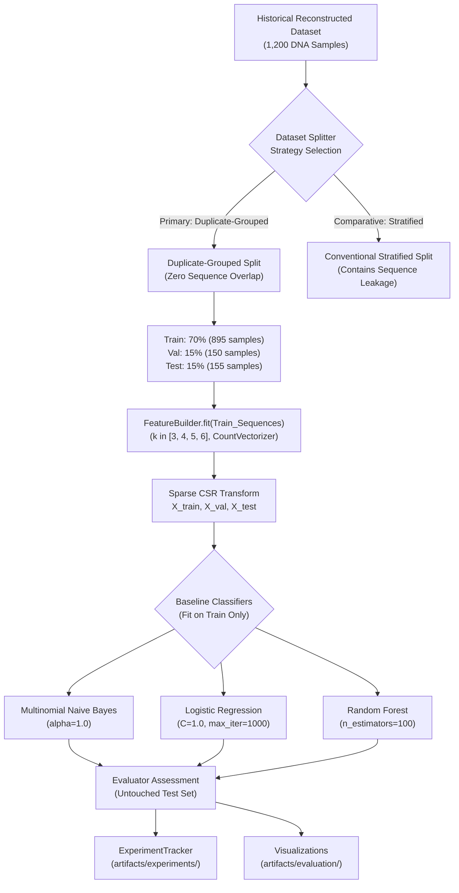

# Baseline Experiment Methodology

**Phase:** 4 - Baseline Machine Learning Benchmark System  
**Dataset:** Reconstructed Historical 1,200 DNA Sequences (`data/interim/historical_reconstruction/DNAdata_reconstructed.csv`)  
**SHA-256 Checksum:** `eb14d47f3eee...`  
**Status:** Methodologically Rigorous & Leakage-Free  

---

## 1. Important Scientific & Clinical Disclaimer

> [!IMPORTANT]
> **Educational Benchmark Only:** The 1,200-sample dataset used in this benchmark contains coding sequences (CDS) from human chromosome 15 and three bacterial species (*Ktedonobacter racemifer*, *Saliniradius amylolyticus*, and *Adhaeribacter pallidiroseus*).
> 
> The target labels (`Cervical Cancer`, `Colorectal Cancer`, `Endometrial Cancer`, `Liver Cancer`) were arbitrarily assigned in the legacy college repository and **do not reflect clinical patient diagnoses, somatic oncology signatures, or clinical trial outcomes**.
> 
> Under no circumstances should performance metrics from this benchmark be cited as evidence of cancer detection or clinical diagnostic capability.

---

## 2. Experimental Design & Architecture



---

## 3. Data Partitioning & Leakage Prevention Protocol

### 3.1 The Sequence Duplication Challenge
In Phase 3.7 forensic analysis, we discovered that **239 out of 300 Cervical Cancer samples are identical duplicate sequences** across 23 gene isoforms. Under naive random or stratified splitting, duplicate copies of identical sequences are partitioned into both training and evaluation folds, allowing models to achieve artificially inflated test scores simply by memorizing training instances.

### 3.2 Duplicate-Grouped Partitioning (Primary Benchmark)
To eliminate sequence leakage, we implemented `split_duplicate_grouped`:
1. **Sequence Hashing:** Every sample sequence is canonicalized (trimmed, converted to uppercase) and mapped to a SHA-256 hash group.
2. **Atomic Group Assignment:** All samples with identical sequences are bound atomically to a single partition group.
3. **Stratified Group Allocation:** Groups are stratified by their target class and partitioned (70% train, 15% validation, 15% test).
4. **Disjointness Audit:** `verify_split_leakage` programmatically proves zero sequence overlap:
   $$\text{Train}_{\text{seqs}} \cap \text{Val}_{\text{seqs}} = \emptyset, \quad \text{Train}_{\text{seqs}} \cap \text{Test}_{\text{seqs}} = \emptyset, \quad \text{Val}_{\text{seqs}} \cap \text{Test}_{\text{seqs}} = \emptyset$$

### 3.3 Conventional Stratified Partitioning (Comparative Benchmark)
We concurrently evaluate standard random stratified splitting (`split_stratified`). This allows us to quantify the exact degree of performance inflation introduced by duplicate leakage in naive pipelines.

### 3.4 Untouched Test Set Protocol
The test partition remains completely quarantined throughout training and validation. It is evaluated exactly once after model training to report unbiased out-of-distribution metrics.

---

## 4. Feature Engineering: DNA k-mer Extraction

### 4.1 Configurable k-mer Frequency Representations
Nucleotide sequences are tokenized into overlapping sliding-window $k$-mers of length $k \in \{3, 4, 5, 6\}$ with stride 1:
- $k=3$: $4^3 = 64$ potential features
- $k=4$: $4^4 = 256$ potential features
- $k=5$: $4^5 = 1,024$ potential features
- $k=6$: $4^6 = 4,096$ potential features

### 4.2 Training-Only Vectorizer Fitting
To prevent global feature leakage (the second major flaw discovered in legacy notebooks), `FeatureBuilder` is fitted **strictly on training sequences**:
```python
feature_builder.fit(train_sequences, train_labels)
X_train = feature_builder.transform_sequences(train_sequences)
X_val = feature_builder.transform_sequences(val_sequences)
X_test = feature_builder.transform_sequences(test_sequences)
```
The test set vocabulary is never inspected or ingested prior to evaluation.

### 4.3 Sparse Matrix Memory Optimization
Unlike naive implementations that call `.toarray()` on high-dimensional vectors, `FeatureBuilder(return_sparse=True)` retains sparse `scipy.sparse.csr_matrix` structures, avoiding unnecessary memory allocations and enabling efficient matrix multiplications.

---

## 5. Baseline Model Specifications

All baseline classifiers implement the common `BaseDNAClassifier` interface:

| Model Identifier | Algorithm Class | Key Hyperparameters | Deterministic Seed | Input Format |
|---|---|---|---|---|
| `MultinomialNB` | Multinomial Naive Bayes | `alpha=1.0`, `fit_prior=True` | N/A | Sparse CSR |
| `LogisticRegression` | L2-Regularized Logistic Regression | `C=1.0`, `max_iter=1000`, `solver='lbfgs'` | `random_state=42` | Sparse CSR |
| `RandomForest` | Ensemble Random Forest Classifier | `n_estimators=100`, `max_depth=None`, `n_jobs=-1` | `random_state=42` | Sparse CSR |

---

## 6. Telemetry & Experiment Tracking

Every experiment run is logged via `ExperimentTracker`:
- **Run Metadata:** UUID, ISO-8601 UTC timestamp, model name, hyperparameters.
- **Dataset Provenance:** Dataset ID, raw file path, SHA-256 integrity checksum.
- **Partition Audit:** Split proportions, group counts, leakage-free boolean status.
- **Feature Metadata:** $k$-mer size, stride, vectorizer type, feature dimensionality ($n_{\text{features}}$).
- **Execution Telemetry:** Training duration (seconds), inference duration (seconds).
- **Metric Vector:** Accuracy, Macro Precision, Macro Recall, Macro F1, Per-class Precision/Recall/F1, Confusion Matrix.
- **Artifact Manifest:** Paths to serialized model weights (`.joblib`), vectorizers, and confusion matrix plots.
- **Privacy Assurance:** Raw biological sequence strings are strictly excluded from logs.

