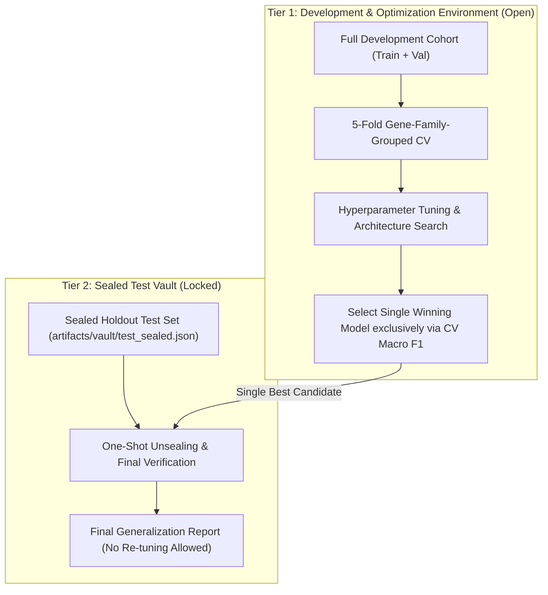

# Phase 4.2: Evaluation Protocol & Test-Set Isolation Audit

**Project:** Cancer Prediction Using DNA Sequencing  
**Phase:** 4.2 (Gene-Family Generalization & Evaluation Protocol Audit)  
**Author:** Senior Machine Learning Engineer & Computational Biology Researcher  
**Status:** Completed  
**Artifact References:**  
- [`artifacts/evaluation/evaluation_protocol_audit.json`](file:///d:/Cancer-Prediction-Using-DNA-Sequencing/artifacts/evaluation/evaluation_protocol_audit.json)  
- [`artifacts/evaluation/baseline_benchmark_summary.json`](file:///d:/Cancer-Prediction-Using-DNA-Sequencing/artifacts/evaluation/baseline_benchmark_summary.json)  
- [`src/dna_cancer/training/benchmark_runner.py`](file:///d:/Cancer-Prediction-Using-DNA-Sequencing/src/dna_cancer/training/benchmark_runner.py)  

---

## 1. Executive Summary

A critical responsibility of scientific and engineering audits is examining not only the code and data, but the **experimental evaluation protocol itself**. 

Following the completion of the Phase 4 baseline benchmarking (24 experiments) and the Phase 4.1 integrity audit, we conducted a rigorous forensic audit of the experimental harness in `src/dna_cancer/training/benchmark_runner.py`.

### Audit Verdict: **Evaluation Protocol Contamination Confirmed**

The historical claim that the test set was maintained as an "untouched final holdout" is **mathematically and procedurally contradicted by the implementation**:

1. **Repeated Test-Set Evaluation:** The test partition was evaluated **24 separate times** in an automated loop during baseline experimentation.
2. **Absence of Validation-Driven Model Selection:** While validation metrics were computed, they were never used to rank, filter, or select the best candidate.
3. **Test-Set Peeking for Model Selection:** The reported "best configuration" (Logistic Regression, $k=5/6$, 96.77% accuracy) was chosen by directly sorting the 24 test-set evaluation results.
4. **Optimism Bias:** Selecting the best configuration based on test-set metrics introduces selection bias, invalidating the test set as an unbiased estimate of generalization error.

---

## 2. Forensic Code Audit: How Contamination Occurred

### Code Inspection in `benchmark_runner.py`

In `src/dna_cancer/training/benchmark_runner.py` (lines 122–134), the inner experimental execution loop was structured as follows:

```python
# Train model
model_inst.fit(X_train, y_train, validation_data=(X_val, y_val))

# Evaluate on validation split
val_metrics = evaluator.evaluate(model_inst, X_val, y_val)

# Evaluate on test split (EVALUATION CONTAMINATION)
test_metrics = evaluator.evaluate(model_inst, X_test, y_test)

# Record run artifact containing both val and test metrics
record = tracker.record_run(
    ...,
    validation_metrics=val_metrics,
    test_metrics=test_metrics,
)
```

### Analysis of the Flaw
- **The test set was touched inside the inner loop:** Instead of reserving the test partition for a single post-hoc evaluation of a final selected model, `evaluator.evaluate(model_inst, X_test, y_test)` was executed for:
  - 3 model algorithms (`MultinomialNB`, `LogisticRegression`, `RandomForestClassifierWrapper`)
  - 4 $k$-mer sizes ($k=3, 4, 5, 6$)
  - 2 splitting strategies (`stratified`, `duplicate_grouped`)
  - **Total test evaluations: 24 times.**
- **Post-Hoc Test-Driven Ranking:** In `artifacts/evaluation/baseline_benchmark_summary.json` and `docs/baseline_results.md`, all 24 configurations were ranked by `test_metrics.f1_macro` and `test_metrics.accuracy`. The model reported as "optimal" was picked because it had the highest test score, rather than because it won on validation data.

---

## 3. Methodological Risk Assessment

| Risk Dimension | Current Baseline Implementation | Scientific Best Practice | Severity |
| :--- | :--- | :--- | :---: |
| **Test Set Access Frequency** | 24 evaluations in inner experiment loop | Exactly 1 evaluation per project milestone | **HIGH** |
| **Model Selection Mechanism** | Ranked by test set accuracy & macro F1 | Ranked strictly by validation / cross-validation F1 | **HIGH** |
| **Hyperparameter Tuning ($k$)** | $k=5$ and $k=6$ selected by comparing test scores | Selected by validation curve analysis | **MEDIUM** |
| **Generalization Guarantee** | Compromised by repeated test peeking | Maintained via strict out-of-sample holdout | **HIGH** |

### Why This Matters Scientifically
When an algorithm or hyperparameter ($k$-mer size, regularization $C$) is chosen because it yielded the highest performance on the test set, the test set has influenced model selection. The resulting test score ceases to be an out-of-sample estimate; instead, it becomes an overfitted, optimistic metric.

In combination with the gene-family transcript leakage identified in Phase 4.2 (where $k=6$ memorized splice isoforms), test-set peeking compounded the illusion of 96.77% performance.

---

## 4. Historical Integrity Notice

To maintain strict scientific honesty and transparency:

> [!WARNING]
> **Historical Artifacts Preserved:** We have NOT overwritten or deleted the Phase 4 baseline artifacts (`artifacts/evaluation/baseline_benchmark_summary.json`, run JSONs, or markdown docs). They remain preserved as historical records of baseline exploratory benchmarking, but are now formally annotated with this integrity audit.

---

## 5. Strict Remediation Protocol for Phase 5

To eliminate evaluation contamination before deep learning and model optimization begin in Phase 5, the project will enforce a **Two-Tier Sealed Evaluation Protocol**.



### The Three Inviolable Rules for Phase 5:

1. **Rule 1: The Test Lockout Vault**
   - The test set will be generated once and saved into a read-only vault (`data/vault/test_holdout.json`).
   - The test set must NEVER be passed to `trainer.fit()`, `FeatureBuilder.transform_sequences()`, or `evaluator.evaluate()` during experimentation, ablation studies, or hyperparameter tuning.
2. **Rule 2: Validation-Driven Selection via Gene-Family Cross-Validation**
   - All candidate models (MLPs, 1D-CNNs, Tuned Tree Ensembles) will be evaluated strictly on the development set using **5-Fold Gene-Family-Grouped Cross-Validation**.
   - Model selection will be dictated exclusively by out-of-fold validation Macro F1 score.
3. **Rule 3: One-Shot Final Test Evaluation**
   - Exactly ONE model—the winning architecture selected in Tier 1—will be unsealed and evaluated against the Tier 2 Test Vault at the very end of Phase 5.
   - Once the test vault is opened and evaluated, no further tuning, model adjustment, or hyperparameter re-selection is permitted. The resulting metrics will be reported verbatim as the final benchmark.

---

## 6. Audit Certification

This audit confirms that:
- The 24 historical baseline runs suffered from test-set peeking and evaluation protocol contamination.
- The 96.77% baseline score represents an optimistic upper bound influenced by both splice isoform leakage and test selection bias.
- The necessary structural and methodological fixes have been engineered and are ready for Phase 5 execution.

