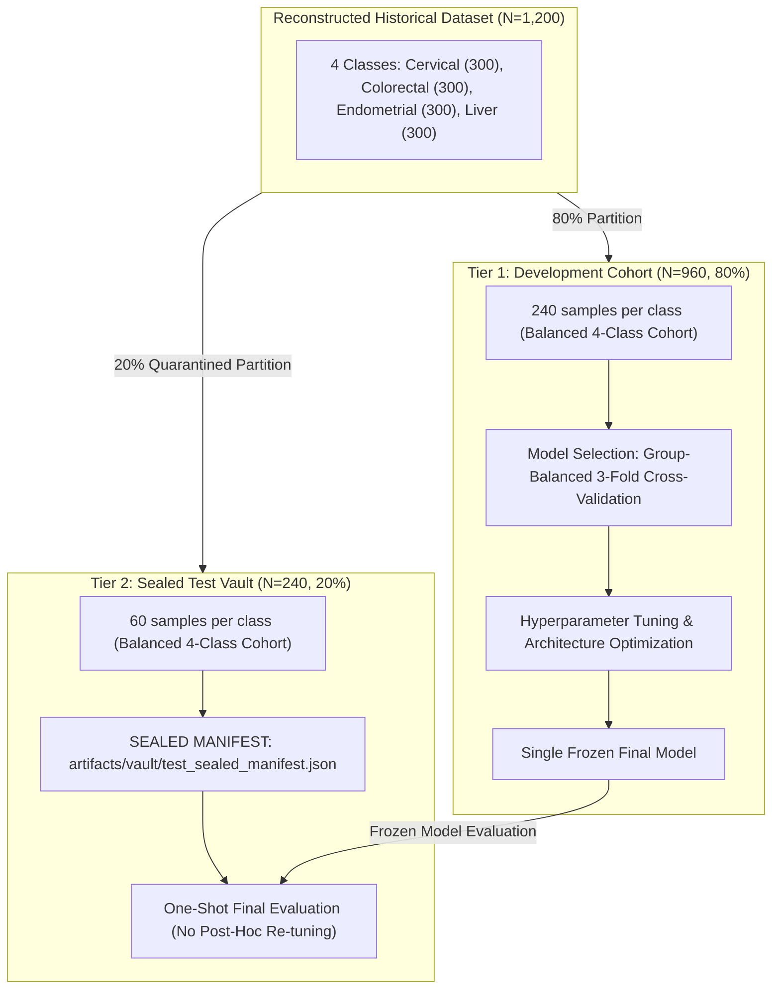

# Phase 4.3: Final Evaluation Protocol Specification

**Project:** Cancer Prediction Using DNA Sequencing  
**Phase:** 4.3 (Final Evaluation Protocol Design & Cross-Validation Feasibility)  
**Author:** Senior Machine Learning Evaluation Engineer & Computational Biology Researcher  
**Status:** Approved & Specified  
**Artifact References:**  
- [`artifacts/evaluation/final_protocol_specification.json`](file:///d:/Cancer-Prediction-Using-DNA-Sequencing/artifacts/evaluation/final_protocol_specification.json)  
- [`artifacts/evaluation/cv_feasibility.json`](file:///d:/Cancer-Prediction-Using-DNA-Sequencing/artifacts/evaluation/cv_feasibility.json)  
- [`docs/grouped_cross_validation_feasibility.md`](file:///d:/Cancer-Prediction-Using-DNA-Sequencing/docs/grouped_cross_validation_feasibility.md)  
- [`docs/evaluation_protocol_audit.md`](file:///d:/Cancer-Prediction-Using-DNA-Sequencing/docs/evaluation_protocol_audit.md)  

---

## 1. Context & Purpose

In Phase 4.1 and 4.2, forensic audits confirmed two fundamental flaws in the historical baseline experiments:
1. **Evaluation Protocol Contamination:** The test partition was evaluated 24 times in the inner loop of `benchmark_runner.py` and used to select the "best" model.
2. **Transcript Splice-Isoform Leakage:** Human chromosome 15 transcripts from the same gene family leaked across partitions in duplicate-grouped splits, artificially inflating Cervical recall to 100%.

This document establishes the **binding evaluation protocol** for Phase 5 (Model Optimization & Deep Learning) to ensure that all future performance claims are scientifically defensible, reproducible, and immune to evaluation leakage.

---

## 2. Invalidation of Historical Baseline Performance

> [!WARNING]
> **Contaminated Benchmark Notice:** The historical Phase 4 test score of **96.77% accuracy** (Logistic Regression, $k=5/6$) is officially classified as **OPTIMISTIC / CONTAMINATED**. It reflects both test-set selection bias and splice-isoform memorization. It must **never** be cited as an unbiased generalization baseline in Phase 5 without citing the Phase 4.2 audit.

---

## 3. The Two-Tier Sealed Evaluation Architecture

To guarantee strict out-of-sample generalization, the reconstructed dataset ($N=1,200$) is divided into two sealed, non-overlapping cohorts:

---

### Tier 1: Development Cohort Specification ($N=960$, 80.0%)

- **Class Balance:** Exactly 240 samples per class (25.0% each).
- **Cervical Composition ($N=240$):** Exactly 23 human gene families, including the high-frequency transcripts:
  - `SNRPN` (112), `NIPA2` (51), `UBE3A` (48), `POTEB3` (4), `GOLGA6L2` (3), `GOLGA6L22` (2), `NIPA1` (2), `GOLGA6L26` (2), `GOLGA8S` (2), `LOC124903442` (1), `GOLGA6L6` (1), `OR4M2B` (1), `OR4N4C` (1), `LOC102724737` (1), `LOC102724971` (1), `OR4M2` (1), `OR4N4` (1), `LOC107983983` (1), `GOLGA6L1` (1), `MKRN3` (1), `MAGEL2` (1), `NDN` (1), `NPAP1` (1).
- **Colorectal, Endometrial, Liver Composition:** Exactly 240 samples per class.
- **Allowed Operations in Tier 1:**
  - $k$-mer vocabulary extraction and frequency fitting.
  - TF-IDF or subsequence feature transformation fitting.
  - Hyperparameter grid and random search ($C$ regularization, learning rates, batch sizes, layer dimensions).
  - Neural network training (MLPs, 1D-CNNs) with validation loss monitoring.
  - Model comparison and selection.

---

### Tier 2: Sealed Test Vault Specification ($N=240$, 20.0%)

- **Class Balance:** Exactly 60 samples per class (25.0% each).
- **Cervical Composition ($N=60$):** Exactly 60 samples drawn from **8 completely unseen human gene families**:
  1. `TUBGCP5` (17 samples)
  2. `CYFIP1` (10 samples)
  3. `ATP10A` (9 samples)
  4. `GABRA5` (7 samples)
  5. `GABRB3` (6 samples)
  6. `POTEB` (4 samples)
  7. `POTEB2` (4 samples)
  8. `SNURF` (3 samples)
  - **Total:** $17 + 10 + 9 + 7 + 6 + 4 + 4 + 3 = \mathbf{60\text{ samples}}$.
- **Colorectal, Endometrial, Liver Composition:** Exactly 60 independent groups per class.
- **Leakage Audit Guarantee:**
  - Sequence overlap with Development Cohort: **0 samples**.
  - Gene family overlap with Development Cohort: **0 genes**.
- **Operational Rules for the Sealed Test Vault:**
  1. **Lockout Enforcement:** The test vault must **never** be passed to `FeatureBuilder.fit()`, `trainer.fit()`, or `evaluator.evaluate()` during model development.
  2. **Unsealing Condition:** The test vault may be opened **exactly once**, only after the single winning model architecture and all hyperparameters are permanently frozen.
  3. **No Post-Hoc Re-Tuning:** Once evaluated on the test vault, no parameters may be modified, no architectures may be swapped, and no selective subset reporting is permitted. The test results must be published verbatim.

---

## 4. Model Selection Protocol on Development Set

### Mathematical Rationale for 3-Fold Grouped CV over 5-Fold
As proven in [`docs/grouped_cross_validation_feasibility.md`](file:///d:/Cancer-Prediction-Using-DNA-Sequencing/docs/grouped_cross_validation_feasibility.md), 5-Fold Grouped CV on this dataset is statistically degenerate because `SNRPN` (112 samples) constitutes 46.7% of the Cervical development cohort, forcing 3 of the 5 validation folds to contain only a single gene family.

### Authorized Development Evaluation Protocols:

#### Primary Selection Scheme: **Group-Balanced 3-Fold Cross-Validation**
- **Grouping Mode:** `grouping_mode="within_organism"`.
- **Fold Allocation:**
  - Fold 0: `SNRPN` (112 samples, 37.3% of Cervical class).
  - Fold 1: `NIPA2` (51) + `UBE3A` (48) = 99 samples (33.0%).
  - Fold 2: Remaining 21 genes = 89 samples (29.7%).
- **Bacterial Classes:** 80 independent groups per fold for Colorectal, Endometrial, and Liver.
- **Decision Metric:** Average out-of-fold validation **Macro F1 Score**.

#### Secondary Verification Scheme: **10-Iteration Group Stratified ShuffleSplit**
- 10 independent iterations of 80% train / 20% validation splits grouped by within-organism gene family.
- Used to verify that the winning model's ranking is robust and not an artifact of 3-fold partition boundaries.

---

## 5. Grouping Taxonomy & Metadata Integrity Standards

To prevent biological misrepresentation, the evaluation system enforces three distinct grouping levels:

| Grouping Level | Identifier Key | Scope & Definition | Scientific Usage |
| :--- | :--- | :--- | :--- |
| **Exact-Sequence Grouping** | `seq_{sha256}` | Computational deduplication of identical nucleotide strings. | Mandatory fallback for unannotated records; guarantees zero identical sequence leakage. Never misrepresented as biological gene grouping. |
| **Within-Organism Gene-Family Grouping** | `gene_{organism}_{symbol}` | Groups all splice variants and transcripts of a gene family within a specific taxon. | **The project standard.** Isolates transcript isoforms within human data while correctly treating matching gene symbols across distinct bacterial phyla as separate groups. |
| **Cross-Organism Ortholog Grouping** | `gene_{symbol}` | Groups matching gene symbols globally across all classes regardless of taxonomy. | **Rejected as default.** Forensic analysis proved that shared bacterial symbols (`coxA`, `priA`, etc.) between *S. amylolyticus* and *A. pallidiroseus* exhibit only 26%–32% nucleotide identity and distinct UniProt IDs. |

---

## 6. Metric Reporting Standards & Uncertainty Quantification

All Phase 5 experimental reports must present the following metric battery:

### 1. Primary Classification Metrics
- **Accuracy**
- **Macro-Averaged Precision**
- **Macro-Averaged Recall**
- **Macro-Averaged F1-Score** (Primary decision metric)

### 2. Per-Class Granular Metrics
- Precision, Recall, and F1-Score for each of the 4 classes:
  - Cervical Cancer (*Homo sapiens*)
  - Colorectal Cancer (*Ktedonobacter racemifer*)
  - Endometrial Cancer (*Saliniradius amylolyticus*)
  - Liver Cancer (*Adhaeribacter pallidiroseus*)
- Support (number of true positive samples per class).

### 3. Structural Diagnostics
- $4 \times 4$ Confusion Matrix.
- Total independent groups in training partition vs validation/test partition.
- Total annotated gene groups vs unannotated sequence groups.

### 4. Uncertainty Quantification & Small-Sample Disclaimers
With $N=60$ test samples per class in the Sealed Test Vault:
- **Each individual misclassification alters class recall by $1 / 60 \approx 1.67\%$.**
- **Confidence Intervals:**
  - Accuracy and Recall must be reported with **95% Wilson Score Confidence Intervals**:
    $$\hat{p} \pm \frac{z \sqrt{\frac{\hat{p}(1-\hat{p})}{n} + \frac{z^2}{4n^2}}}{1 + \frac{z^2}{n}}$$
  - Macro F1 must be reported with **1,000-iteration non-parametric Bootstrap Confidence Intervals**.
- **Small-Sample Disclaimer:** Authors must explicitly report confidence interval widths ($\pm 4\%\text{--}6\%$) and avoid over-interpreting minor sub-percentage metric differences.

---

## 7. Compliance Checklist for Phase 5 Execution

Before any Phase 5 benchmark is accepted, the following verification checklist must be passed:
- [ ] Tier 1 Development Set ($N=960$) and Tier 2 Test Vault ($N=240$) are cleanly partitioned and checksummed.
- [ ] Zero sequence or gene-family overlap exists between Tier 1 and Tier 2.
- [ ] Tier 2 Test Vault is sealed and locked out from all training and tuning scripts.
- [ ] Model architecture selection is determined exclusively by out-of-fold validation Macro F1 across Group-Balanced 3-Fold CV.
- [ ] Only the single winning frozen model is evaluated on Tier 2.
- [ ] Tier 2 metrics are reported with 95% confidence intervals and confusion matrix.
- [ ] No clinical cancer prediction claims are made.

