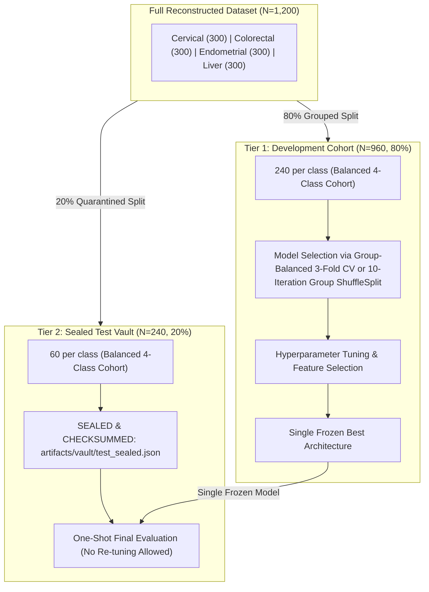

# Phase 4.3: Grouped Cross-Validation Feasibility & Partition Integrity Audit

**Project:** Cancer Prediction Using DNA Sequencing  
**Phase:** 4.3 (Final Evaluation Protocol Design & Cross-Validation Feasibility)  
**Author:** Senior Machine Learning Evaluation Engineer & Computational Biology Researcher  
**Status:** Completed  
**Artifact References:**  
- [`artifacts/evaluation/cv_feasibility.json`](file:///d:/Cancer-Prediction-Using-DNA-Sequencing/artifacts/evaluation/cv_feasibility.json)  
- [`artifacts/evaluation/final_protocol_specification.json`](file:///d:/Cancer-Prediction-Using-DNA-Sequencing/artifacts/evaluation/final_protocol_specification.json)  
- [`docs/gene_family_generalization_audit.md`](file:///d:/Cancer-Prediction-Using-DNA-Sequencing/docs/gene_family_generalization_audit.md)  

---

## 1. Executive Summary & Feasibility Verdict

Following the discovery in Phase 4.2 that duplicate-grouped splitting allowed human transcript splice isoforms to leak across partitions, this phase investigated whether **Five-Fold Gene-Family-Grouped Cross-Validation** is mathematically and statistically feasible on the reconstructed 1,200-sample dataset.

### Formal Feasibility Verdict: **INFEASIBLE FOR 5 FOLDS**

> [!CAUTION]
> **Definitive Finding:** Standard Five-Fold Gene-Family-Grouped Cross-Validation cannot be implemented without inducing severe partition distortion, extreme training class imbalance, and degenerate single-gene validation folds.

### Primary Mathematical & Biological Blockers:
1. **The Heavy-Tail Gene Disparity:** In Cervical Cancer (*Homo sapiens* Chr 15), transcripts of a single gene—`SNRPN`—comprise **112 out of 300 samples (37.33% of the class)**. Because biological gene families are indivisible units, `SNRPN` must reside entirely within a single fold.
2. **Degenerate Single-Gene Validation Folds:** In optimal 5-fold grouping, **3 out of the 5 validation folds (60%) contain transcripts from exactly ONE gene family** (Fold 0: `SNRPN` with 112 samples; Fold 1: `NIPA2` with 51 samples; Fold 2: `UBE3A` with 48 samples). A validation fold containing only one gene does not measure generalized sequence classification; it measures binary memorization of that single transcript.
3. **Severe Training Imbalance:** In the fold where `SNRPN` is held out for validation, the training partition retains only 188 Cervical samples compared to ~240 samples for each bacterial class (a 22% class deficiency).
4. **Extreme Taxonomic Asymmetry:** While the three bacterial classes consist of 298–300 independent groups of size 1 (uniform distribution), Cervical Cancer has only 31 groups with an extreme Gini coefficient of 0.76.

---

## 2. Per-Class Group Structure Census

To avoid assumptions, we performed a full census of group structures across all four classes ($N=300$ samples each, total $N=1,200$).

| Target Class Label | Biological Source Organism | Samples Annotated (`[gene=...]`) | Samples Unannotated | Unique Gene Groups | Unique Seq Groups | Total Independent Groups | Group Size Range |
| :--- | :--- | :---: | :---: | :---: | :---: | :---: | :---: |
| **Cervical Cancer** | *Homo sapiens* (Chr 15 mRNA) | **300 (100.0%)** | 0 (0.0%) | 31 | 0 | **31** | **1 to 112** |
| **Colorectal Cancer** | *Ktedonobacter racemifer* | 0 (0.0%) | 300 (100.0%) | 0 | 298 | **298** | **1 to 2** |
| **Endometrial Cancer** | *Saliniradius amylolyticus* | 73 (24.3%) | 227 (75.7%) | 73 | 227 | **300** | **1 to 1** |
| **Liver Cancer** | *Adhaeribacter pallidiroseus* | 75 (25.0%) | 225 (75.0%) | 75 | 225 | **300** | **1 to 1** |

### Cervical Cancer Group Size Breakdown
The 300 human cervical cancer sequences originate from exactly 31 distinct gene families on chromosome 15:

| Gene Symbol | Sample Count | % of Cervical Class | Cumulative Samples | Cumulative % | Biological Context |
| :--- | :---: | :---: | :---: | :---: | :--- |
| **SNRPN** | **112** | **37.33%** | 112 | 37.33% | Small nuclear ribonucleoprotein polypeptide N (heavily alternative-spliced) |
| **NIPA2** | **51** | **17.00%** | 163 | 54.33% | Non-imprinted in Prader-Willi/Angelman syndrome region protein 2 |
| **UBE3A** | **48** | **16.00%** | 211 | 70.33% | Ubiquitin protein ligase E3A (multiple brain/transcript isoforms) |
| **TUBGCP5** | **17** | **5.67%** | 228 | 76.00% | Tubulin gamma complex associated protein 5 |
| **CYFIP1** | **10** | **3.33%** | 238 | 79.33% | Cytoplasmic FMRP interacting protein 1 |
| **ATP10A** | **9** | **3.00%** | 247 | 82.33% | ATPase phospholipid transporting 10A |
| **GABRA5** | **7** | **2.33%** | 254 | 84.67% | Gamma-aminobutyric acid type A receptor subunit alpha5 |
| **GABRB3** | **6** | **2.00%** | 260 | 86.67% | Gamma-aminobutyric acid type A receptor subunit beta3 |
| **POTEB2, POTEB3, POTEB** | **12** | **4.00%** | 272 | 90.67% | POTE ankyrin domain family members (4 samples each) |
| **GOLGA6L2, SNURF** | **6** | **2.00%** | 278 | 92.67% | 3 samples each |
| **GOLGA6L22, NIPA1, etc.** | **8** | **2.67%** | 286 | 95.33% | 4 genes, 2 samples each |
| **Singletons (14 genes)** | **14** | **4.67%** | 300 | 100.00% | `MKRN3`, `MAGEL2`, `NDN`, `NPAP1`, `OR4M2`, etc. (1 each) |

> [!IMPORTANT]
> **The 70% Concentration:** Just **3 gene families** (`SNRPN`, `NIPA2`, `UBE3A`) account for **211 out of 300 samples (70.33%)** of the Cervical Cancer class.

---

## 3. Mathematical Simulation of Cross-Validation Partitions

To evaluate whether five folds could be balanced, we executed greedy optimal bin-packing simulations:

### A. Five-Fold Grouped CV Simulation ($K=5$)

| Fold Index | Validation Cervical Samples | % of Cervical Class | Training Cervical Samples | Gene Groups Count | Gene Groups in Validation Split | Fold Health Assessment |
| :---: | :---: | :---: | :---: | :---: | :--- | :--- |
| **Fold 0** | **112** | **37.33%** | 188 | **1** | `['SNRPN']` | **DEGENERATE:** Single-gene validation; 22% training class deficit. |
| **Fold 1** | **51** | **17.00%** | 249 | **1** | `['NIPA2']` | **DEGENERATE:** Single-gene validation. |
| **Fold 2** | **48** | **16.00%** | 252 | **1** | `['UBE3A']` | **DEGENERATE:** Single-gene validation. |
| **Fold 3** | **45** | **15.00%** | 255 | 14 | `['TUBGCP5', 'GABRB3', 'POTEB3', ...]` | Multi-gene validation. |
| **Fold 4** | **44** | **14.67%** | 256 | 14 | `['CYFIP1', 'ATP10A', 'GABRA5', ...]` | Multi-gene validation. |

#### Why 5-Fold Grouped CV Fails Scientifically:
1. In Folds 0, 1, and 2, validation metrics are binary reflections of a single gene. If the model misclassifies `SNRPN` (e.g., predicting it as bacterial), Cervical recall in Fold 0 is **0.0%**. If it classifies it correctly, Cervical recall is **100.0%**.
2. This creates extreme bimodal variance across folds that drowns out meaningful comparison between model architectures.
3. Training set sizes oscillate between 188 and 256 samples for Cervical Cancer, confounding learning curve stability.

---

### B. Three-Fold Grouped CV Simulation ($K=3$)

| Fold Index | Validation Cervical Samples | % of Cervical Class | Training Cervical Samples | Gene Groups Count | Included Genes |
| :---: | :---: | :---: | :---: | :---: | :--- |
| **Fold 0** | **112** | **37.33%** | 188 | 1 | `['SNRPN']` |
| **Fold 1** | **99** | **33.00%** | 201 | 2 | `['NIPA2', 'UBE3A']` |
| **Fold 2** | **89** | **29.67%** | 211 | 28 | `['TUBGCP5', 'CYFIP1', 'ATP10A', ...]` |

While Fold 0 still isolates `SNRPN`, the sample balance (37.3%, 33.0%, 29.7%) and training set sizes (188, 201, 211) are substantially more stable than 5 folds.

---

## 4. Analysis of Strict Annotated Cohort ($N=448$)

Filtering the dataset to only samples possessing verified NCBI gene symbols yields:
- **Cervical:** 300 samples (31 genes)
- **Endometrial:** 73 samples (73 genes, all singletons)
- **Liver:** 75 samples (75 genes, all singletons)
- **Colorectal:** 0 samples (completely unannotated by gene symbol; dropped)

In a 5-fold grouped split of this 3-class subset:
- Each validation fold would contain only **14 Endometrial samples** and **15 Liver samples**.
- With $N=14$, a single misclassification causes a **7.14% drop in recall**, producing wide sampling errors.
- Cervical still suffers from the 112-sample `SNRPN` concentration.

---

## 5. Forensic Audit of Cross-Class Shared Bacterial Gene Symbols

The Endometrial (*Saliniradius amylolyticus*) and Liver (*Adhaeribacter pallidiroseus*) datasets share five gene symbols: `coxA`, `coxB`, `coxC`, `cyoE`, `priA`. We audited whether these represent identical biological sequences or merely coincident functional nomenclature:

| Gene Symbol | Endometrial Length (bp) | Liver Length (bp) | Endometrial UniProt | Liver UniProt | Prefix Nucleotide Identity | Sequence-Level Orthology Verified? |
| :--- | :---: | :---: | :---: | :---: | :---: | :---: |
| **coxA** | 1,590 | 207 | `P33518` | None | **26.09%** | **NO** (chance identity) |
| **coxB** | 1,137 | 159 | `Q1RI44` | None | **28.93%** | **NO** (chance identity) |
| **coxC** | 879 | 492 | `P34842` | `P48873` | **28.66%** | **NO** (distinct UniProt IDs) |
| **cyoE** | 915 | 897 | `A6UXP9` | `Q3SW48` | **32.11%** | **NO** (distinct UniProt IDs) |
| **priA** | 2,190 | 2,529 | `Q8KA15` | `P94461` | **26.76%** | **NO** (distinct UniProt IDs) |

### Biological Verdict on Shared Symbols:
1. Direct nucleotide identity across these five genes is between **26.1% and 32.1%** (which is indistinguishable from random 4-base DNA background chance).
2. The organisms belong to distinct bacterial phyla (*Bacillota* vs *Bacteroidota*).
3. The matching gene symbols are functional enzyme identifiers (e.g. Cytochrome-c oxidase), not sequence-identical genes.
4. **Implementation Decision:** Grouping must be performed using **within-organism context** (`f"gene_{organism}_{gene}"`). Cross-organism ortholog grouping is rejected because sequence-level orthology cannot be substantiated from the metadata.

---

## 6. Recommended Phase 5 Evaluation Architecture

Given that 5-fold grouped CV is infeasible, we recommend the **Two-Tier Sealed Evaluation Architecture**:

### Partition Boundary Rules:
1. **Tier 1 (Development Set, $N=960$):**
   - 240 Cervical (23 gene families, including `SNRPN` = 112, `NIPA2` = 51).
   - 240 Colorectal, 240 Endometrial, 240 Liver.
   - Evaluated using **Group-Balanced 3-Fold CV** or **Repeated Group Stratified ShuffleSplit** (10 iterations).
2. **Tier 2 (Sealed Test Vault, $N=240$):**
   - Exactly 60 samples per class.
   - Cervical holdout contains 60 samples across 8 unseen human genes:
     `ATP10A` (9), `TUBGCP5` (17), `CYFIP1` (10), `GABRA5` (7), `GABRB3` (6), `POTEB` (4), `POTEB2` (4), `SNURF` (3).
   - **Zero sequence or gene-family overlap with Development Set.**
   - Evaluated **strictly once** after model and configuration are frozen.

