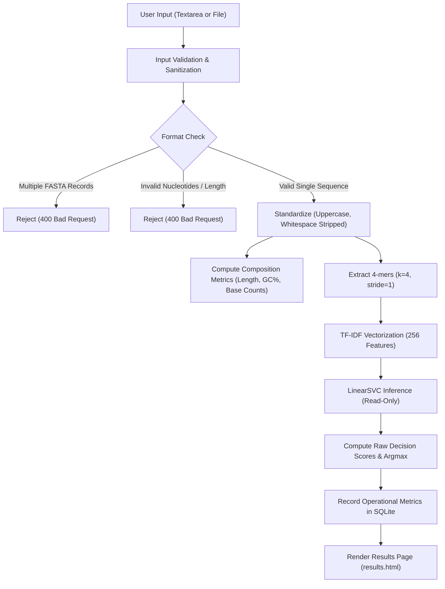

# Local Web Application User & Engineering Guide

This document describes the architecture, installation, operation, verification, and scientific guardrails of the local web application for the DNA Sequence Classification project.

---

## 1. System Architecture

The local web serving layer provides an interactive scientific dashboard for evaluating DNA sequences against the verified, frozen Phase 5 candidate model.

```text
D:\Cancer-Prediction-Using-DNA-Sequencing\
├── run.py                          # Local server entry point (http://127.0.0.1:5000)
├── app/
│   ├── __init__.py                 # Flask application factory (create_app)
│   ├── routes.py                   # HTTP routing & controller handlers
│   ├── services/
│   │   ├── __init__.py
│   │   ├── prediction_service.py   # Frozen model inference, validation, stats
│   │   └── history_service.py      # Parameterized SQLite session history
│   ├── templates/
│   │   ├── base.html               # Master layout, navigation, disclosure banner
│   │   ├── index.html              # Main dashboard, sequence textarea, file upload
│   │   ├── results.html            # Classification results, raw decision scores, GC%
│   │   ├── history.html            # Local SQLite prediction history
│   │   └── 404.html                # Error and fallback view
│   └── static/
│       ├── css/
│       │   └── style.css           # Custom dark biotech aesthetic stylesheet
│       └── js/
│           └── app.js              # Vanilla JS: counter, live validation, drag-and-drop
└── artifacts/
    ├── history/
    │   └── prediction_history.db   # Local SQLite database (metadata only)
    └── models/
        └── phase5_best_candidate/  # Verified frozen candidate artifacts
            ├── model.joblib        # LinearSVC model
            ├── vectorizer.joblib   # TF-IDF (k=4, 256 vocabulary features)
            ├── encoder.joblib      # 4-class label encoder
            ├── model_config.json   # Model hyperparameters & CV metrics
            └── checksums.sha256    # Cryptographic integrity checksums
```

### Key Technical Characteristics

| Component | Specification |
| :--- | :--- |
| **Backend Framework** | Python 3.8+ / Flask 3.0+ |
| **Model Candidate** | `LinearSVC` (\(C=1.0\), max_iter=2000, squared hinge loss) |
| **Feature Representation** | 4-mer tokens (\(k=4\)), TF-IDF frequency representation, 256 vocabulary tokens |
| **Inference Mode** | Strictly read-only & frozen. Zero runtime training or vectorizer refitting. |
| **Scores Reported** | Raw signed hyperplane decision scores (\(w_k^T x + b_k\)). Not probabilities. |
| **History Persistence** | Local disk-backed SQLite with parameterized queries. |
| **Security Controls** | Session CSRF tokens, strict file extension validation, 5 MB file upload ceiling, 50,000 bp length cap. |

---

## 2. Environment Setup & Installation

### Prerequisites

- Python 3.8, 3.9, 3.10, 3.11, or 3.12 (Python 3.8 verified).
- Windows, macOS, or Linux.

### Installation Steps

1. **Navigate to the project root:**
   ```powershell
   cd D:\Cancer-Prediction-Using-DNA-Sequencing
   ```

2. **Activate your virtual environment or use your configured Python binary:**
   ```powershell
   # Using existing Python environment
   & "C:\Users\HP\AppData\Local\Programs\Python\Python38\python.exe" -m pip install -r requirements.txt
   ```

3. **Verify installed packages:**
   ```powershell
   & "C:\Users\HP\AppData\Local\Programs\Python\Python38\python.exe" -c "import flask, sklearn, joblib; print('All web dependencies verified')"
   ```

---

## 3. Starting the Web Application

To start the local application using the standard entry point:

```powershell
python run.py
```
*(Or with explicit executable path: `& "C:\Users\HP\AppData\Local\Programs\Python\Python38\python.exe" run.py`)*

The server will output:

```text
=================================================================
  DNA Sequence Classification — Local Web Application
=================================================================
  Local URL:        http://127.0.0.1:5000
  Binding:          Localhost only (isolated from external network)
  Debug Mode:       False
  Model Candidate:  LinearSVC (k=4, TF-IDF standard representation)
  Dataset Notice:   Educational sequence-source classification only
=================================================================
```

### Accessing the Dashboard

Open your web browser and navigate to:

[http://127.0.0.1:5000](http://127.0.0.1:5000)

> [!IMPORTANT]
> The server binds strictly to `127.0.0.1` (localhost). External network interfaces (`0.0.0.0`) are not exposed by default for security.

---

## 4. Supported Input Formats & Validation Rules

The application supports both direct pasting and file uploads.

### Supported Input Types

1. **Raw Nucleotide Strings:**
   - Standard uppercase or lowercase text (e.g. `ATGCAATTGGC...`).
   - Mixed whitespace, carriage returns, and tabs are cleaned automatically.
2. **Single-Record FASTA:**
   - Must contain a single header beginning with `>` followed by sequence lines:
     ```text
     >sample_accession_001 | Synthetic demo
     ATGGCGTACGTTAGCTAGCTAGCTGATCGA
     TCGATCGTAGCTAGCTAGCTAGCTAGCTAG
     ```
3. **File Uploads:**
   - Supported extensions: `.fasta`, `.fa`, `.fna`, `.txt`.
   - Maximum upload size: 5 MB.

### Validation Constraints

- **Alphabet:** Valid characters are `A`, `C`, `G`, `T`, and ambiguous base `N` (case-insensitive). Non-nucleotide characters (e.g. digits, punctuation, amino acid codes) are rejected with a descriptive error.
- **Minimum Length:** Must be at least 4 nucleotides (\(k=4\)) to compute 4-mer frequency features.
- **Maximum Length:** Capped at 50,000 bp (configurable via `MAX_SEQUENCE_LENGTH`). Sequences are **never** silently truncated.
- **Multi-Record FASTA:** Files or inputs containing multiple FASTA records are rejected with an explicit error detailing the detected headers.

---

## 5. Prediction Workflow & Output Interpretation



### Interpreting Decision Scores

LinearSVC optimizes the margin between linear hyperplanes:
\[
f_k(x) = w_k^T x + b_k
\]
- **Score Meaning:** The signed perpendicular distance from the decision boundary for class \(k\).
- **Positive Scores:** Sample lies on the positive side of the margin for that historical category.
- **Negative Scores:** Sample lies on the negative side of the margin.
- **Important:** These values are **uncalibrated decision scores, NOT probabilities or confidence percentages**. They are presented honestly as signed distances.

---

## 6. Prediction History

Local prediction history is stored in SQLite at `artifacts/history/prediction_history.db`.

### Privacy and Data Minimization Guarantees

1. **No Complete Sequences Stored:** Only operational metadata is persisted:
   - Timestamp (UTC)
   - Record Label (e.g. FASTA header preview or "Direct Input")
   - Predicted Class Name
   - Sequence Length (bp)
   - GC Content (%)
   - Model Identifier
2. **No Patient Information:** No identifiable clinical data is ever accepted or stored.
3. **Parameterized Queries:** All SQL executions use `?` parameter substitution to eliminate injection risks.
4. **User-Controlled Clearing:** History can be wiped at any time from the `/history` interface upon explicit confirmation.

---

## 7. Mandatory Scientific Disclosure

> [!WARNING]
> **Mandatory Educational Disclosure:**
> This application is strictly an educational DNA sequence-source classification project.
> Its training dataset has known biological provenance limitations and is **not clinically validated**.
>
> Forensic analysis revealed that sequences labeled Cervical in the historical dataset are human chromosome 15 transcripts, while sequences labeled Colorectal, Endometrial, and Liver are bacterial genomic sequences.
> Predictions must **never** be interpreted as cancer diagnoses, tumor identifications, or medical advice.

---

## 8. Verified Holdout Evaluation Benchmark

The Phase 5 frozen candidate was evaluated exactly once against the sealed Tier 2 holdout dataset (\(N=240\)). The evaluation yielded:

- **Overall Accuracy:** 91.25% (219 / 240 correct, 95% CI: [87.0%, 94.2%])
- **Macro F1 Score:** 0.9105
- **Per-Class Recall:**
  - Cervical: 76.67% (46 / 60 correct, 14 misclassifications)
  - Colorectal: 90.00% (54 / 60 correct, 6 misclassifications)
  - Endometrial: 98.33% (59 / 60 correct, 1 misclassification)
  - Liver: 100.00% (60 / 60 correct, 0 misclassifications)

*Note:* Development 3-fold cross-validation achieved a higher score (96.71% Macro F1). The holdout revealed weaker Cervical recall, illustrating generalization limits when predicting across unobserved gene families.

---

## 9. Troubleshooting & FAQ

| Symptom | Cause | Resolution |
| :--- | :--- | :--- |
| `Missing required Phase 5 model artifacts` | Model artifact directory missing files. | Verify that `artifacts/models/phase5_best_candidate/` contains `model.joblib`, `vectorizer.joblib`, `encoder.joblib`, and `model_config.json`. |
| `CSRF token validation failed` | Session expired or submitted without valid CSRF token. | Refresh the page and re-submit the form. |
| `Multiple FASTA records detected` | Uploaded FASTA contains more than one record. | Split the FASTA into individual sequence files and submit one record at a time. |
| `Sequence contains unsupported characters` | Non-ACGTN characters present. | Check for degenerate IUPAC codes (R, Y, S, W, K, M) or numbers and replace with N if unknown. |

